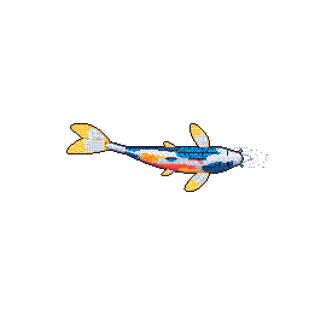

<!-- VIREON · PREMIUM PROFILE -->

  
  

    
    
    
  

  

    <a href="https://t.me/Imperialism12">Telegram</a> ·
    <a href="https://discord.com/users/1419744000977403994">Discord</a> ·
    <a href="https://anilist.co/user/Vireon">AniList</a> ·
    <a href="https://last.fm/user/reasfeetadmirer">Last.fm</a> ·
    <a href="https://open.spotify.com/user/313455ps4aa6ouotajxcn34mwh4a">Spotify</a>
  

  

    
    
    
  

  <strong>Building communities, privacy tools, software systems, and visual experiences.</strong> 
  Curiosity first. Sharp engineering. Unreasonable attention to detail.

---

## 01 / PROFILE

I build community software, privacy-focused tools, web experiences, and automation. Most of the work starts as an idea, turns into a system, and gets refined until every part has a reason to exist. Away from the editor: anime, music, games, and an unreasonable number of open tabs.

## 02 / SELECTED WORK

Every project opens into its own details. The repository index below is refreshed automatically.

<strong>01 · Lunar X</strong> <code>ANIME · MANGA · NOVELS · COMMUNITY PLATFORM</code>

**[Open Lunar X](https://lunarx.to/)** · [Profile](https://lunarx.to/Profile/vvvx)

A media and community platform spanning anime, manga, novels, discovery, profiles, progression systems, games, and supporting infrastructure.

**Reported project footprint: 676,088 lines.**

| Area | Stack | Lines | Estimated characters |
| --- | --- | ---: | ---: |
| Backend | Rust | 265,856 | ≈ 15,951,360 |
| Frontend | Next.js | 309,274 | ≈ 27,834,660 |
| Gacha games | React | 40,751 | ≈ 3,667,590 |
| Scraping & tools | Python | 20,865 | ≈ 1,001,520 |
| Web graphics | WebGL | 20,657 | — |
| 3D rendering | Three.js | 18,685 | — |
| **Total** | | **676,088** | **≈ 48,455,130 known subtotal** |

Character estimates are shown only for the four areas with supplied characters-per-line assumptions. WebGL and Three.js remain line-count-only rather than receiving invented estimates.

<strong>02 · Lemegeton</strong> <code>DISCORD · MEDIA DISCOVERY · MULTI-GUILD</code>

**[Open repository](https://github.com/Kyerstorm/Lemegeton)**

A multi-guild Discord media-discovery platform covering anime, manga, novels, books, games, recommendations, panels, and server-aware discovery.

**Role:** Major contributor and co-owner.

<strong>03 · PrivaCage</strong> <code>PRIVACY · ANDROID · WINDOWS · RUST</code>

**[Open repository](https://github.com/VireonNoctis/PrivaCage)**

A privacy-auditing companion built around local-first inspection, tracker intelligence, app and permission analysis, reversible controls, and a Rust-backed web interface.

*Understand what your device exposes. Block what you can. Know what you cannot.*

<strong>04 · Moonbyte</strong> <code>PIXEL ART · DISCORD · MULTIPLAYER GAME WORLD</code>

**[Open repository](https://github.com/VireonNoctis/Moonbyte)**

A pixel-art gaming world that turns Discord into a multiplayer arcade, with progression, social spaces, minigames, player economies, and interconnected game systems.

<strong>05 · DriftGlass</strong> <code>SOFTWARE FORENSICS · UPDATE COMPARISON</code>

**[Open repository](https://github.com/VireonNoctis/Driftglass)**

A tool for comparing observable behaviour between software versions and preserving reproducible evidence of what changed.

<strong>06 · Vireon website</strong> <code>NEXT.JS · REACT · CINEMATIC UI</code>

**[Open repository](https://github.com/VireonNoctis/VireonNoctis.github.io)** · [Visit website](https://vireonnoctis.github.io/)

A personal web experience for projects, profiles, live activity, language and code-footprint statistics, and distinct visual themes. Its application framework is **Next.js**; TypeScript remains the source language for <code>.ts</code> and <code>.tsx</code> files.

<strong>07 · SwarmForge</strong> <code>DEVELOPER AUTOMATION · PYTHON</code>

**[Open repository](https://github.com/VireonNoctis/SwarmForge)**

A project for coordinating multiple coding assistants into a unified development workflow.

<strong>08 · SkillTether</strong> <code>LANGUAGE · MEANING · TOOLING</code>

**[Open repository](https://github.com/VireonNoctis/SkillTether)**

Language tooling focused on translating words while preserving intent and context.

<strong>09 · Universe Explorer</strong> <code>ASTRONOMY · INTERACTIVE VISUALS</code>

**[Open repository](https://github.com/VireonNoctis/Universe-Explorer)**

A space-themed interactive astronomy explorer.

## 03 / TOOLKIT

  

**Daily environment:** Terminal / CLI · Vim · Neovim · VS Code · GitHub Actions · YAML · Shell

**Exploring:** Vue.js · Angular · PHP · C# · Dart

Technologies in the learning list are not presented as production experience.

## 04 / LIVE REPOSITORY INDEX

The ten most recently updated described public repositories. Open any row for its description, detected source languages, and framework metadata.

<!-- AUTO-REPOSITORIES:START -->

<strong>01 · SwarmForge</strong> <code>UPDATED 2026-11-11</code>

Turn Claude, ChatGPT, and other AI assistants into a unified AI development swarm.

**Repository:** [Open on GitHub](https://github.com/VireonNoctis/SwarmForge)
**Source languages:** Python

<strong>02 · Driftglass</strong> <code>UPDATED 2026-11-11</code>

Every update leaves a trace. Find it.

**Repository:** [Open on GitHub](https://github.com/VireonNoctis/Driftglass)
**Source languages:** C++, JavaScript, Rust, Svelte, CSS, CMake, Swift, TypeScript, Shell, HTML

<strong>03 · PrivaCage</strong> <code>UPDATED 2026-11-08</code>

Know what every app is doing to your device. Right now. In real time.

**Repository:** [Open on GitHub](https://github.com/VireonNoctis/PrivaCage)
**Source languages:** Kotlin, Rust, Go, TypeScript, CSS, Svelte, HTML

<strong>04 · Moonbyte</strong> <code>UPDATED 2026-11-07</code>

Moonbyte is a pixel-art gaming bot that transforms Discord into a multiplayer arcade, featuring classic mini-games, original adventures, RPG experiences, puzzles, and competitive…

**Repository:** [Open on GitHub](https://github.com/VireonNoctis/Moonbyte)
**Source languages:** Rust, CSS, TypeScript, Python

<strong>05 · vvd-reimagined</strong> <code>UPDATED 2026-11-05</code>

A ground-up reconstruction of vvd.world — a comprehensive worldbuilding, novel-writing, collaborative storytelling and publishing platform. Rebuilding its creative ecosystem,…

**Repository:** [Open on GitHub](https://github.com/VireonNoctis/vvd-reimagined)
**Source languages:** Python

<strong>06 · SkillTether</strong> <code>UPDATED 2026-10-31</code>

Translate the words. Preserve the intent.

**Repository:** [Open on GitHub](https://github.com/VireonNoctis/SkillTether)
**Source languages:** Python, HTML

<strong>07 · Universe-Explorer</strong> <code>UPDATED 2026-10-29</code>

Astra is a space-themed interactive astronomy explorer.

**Repository:** [Open on GitHub](https://github.com/VireonNoctis/Universe-Explorer)
**Source languages:** Ruby, JavaScript, CSS

<strong>08 · TreeParity</strong> <code>UPDATED 2026-10-26</code>

An open-source conformance-testing laboratory that measures exactly what happens to a directory tree when it is transferred between operating systems, filesystems, archive…

**Repository:** [Open on GitHub](https://github.com/VireonNoctis/TreeParity)
**Source languages:** Not detected

<strong>09 · Envquake</strong> <code>UPDATED 2026-10-26</code>

A CLI that discovers hidden environmental assumptions in software by rerunning tests under controlled variations of the system environment, identifying the exact conditions that…

**Repository:** [Open on GitHub](https://github.com/VireonNoctis/Envquake)
**Source languages:** Not detected

<strong>10 · FormatFossil</strong> <code>UPDATED 2026-10-26</code>

A file-conversion forensics laboratory that tests what actually survives when files move between formats and software versions.

**Repository:** [Open on GitHub](https://github.com/VireonNoctis/FormatFossil)
**Source languages:** Not detected

<!-- AUTO-REPOSITORIES:END -->

## 05 / CODE FOOTPRINT

Whole-repository totals cover tracked source, configuration, and documentation across owned and contributed public repositories. They describe project size, not personal line-by-line authorship.

<!-- AUTO-CODE-STATS:START -->
**Snapshot: 2026-11-12 UTC** · 19 public repositories (17 owned, 2 contributed).

| Repositories | Tracked files | Lines | Characters | Words | Stars / forks |
| ---: | ---: | ---: | ---: | ---: | ---: |
| 19 | 3,282 | 718,139 | 32,221,862 | 3,316,277 | 2 / 3 |

<strong>Repository footprint</strong> · 19 expandable project records

<strong>Lemegeton</strong> · 89,922 lines · 214 files

[Open repository](https://github.com/Kyerstorm/Lemegeton) · Contributor project
**Contribution:** Major contributor · co-owner

| Source language / format | Lines | Files |
| --- | ---: | ---: |
| Python | 82,858 | 167 |
| Markdown | 5,237 | 17 |
| Batch | 716 | 2 |
| YAML | 365 | 5 |
| Environment config | 244 | 1 |
| JSON | 136 | 7 |
| Git config | 94 | 2 |
| Config | 86 | 3 |
| Plain text | 56 | 4 |
| Dockerfile | 52 | 1 |
| Shell | 33 | 1 |
| TOML | 21 | 2 |
| Docker config | 20 | 1 |
| SVG | 4 | 1 |

<strong>loop-app</strong> · 384,364 lines · 2,143 files

[Open repository](https://github.com/JammyVibez/loop-app) · Contributor project
**Contribution:** Contributor
**Detected frameworks:** Next.js · React

| Source language / format | Lines | Files |
| --- | ---: | ---: |
| TypeScript | 312,453 | 1,697 |
| SQL | 23,762 | 191 |
| JavaScript | 13,666 | 94 |
| Markdown | 9,439 | 39 |
| Rust | 9,053 | 19 |
| CSS | 7,213 | 18 |
| JSON | 4,111 | 15 |
| HTML | 1,352 | 1 |
| SVG | 730 | 12 |
| Plain text | 686 | 9 |
| XML | 334 | 12 |
| Terraform (HCL) | 332 | 4 |
| Shell | 317 | 5 |
| YAML | 241 | 3 |
| Git config | 142 | 4 |
| Gradle | 139 | 6 |
| Batch | 94 | 1 |
| Config | 88 | 1 |
| Environment config | 78 | 2 |
| Java | 49 | 3 |
| TOML | 30 | 2 |
| Properties | 29 | 2 |
| Dockerfile | 20 | 1 |
| Docker config | 5 | 1 |
| NPM config | 1 | 1 |

<strong>Anilist-Css</strong> · 2,044 lines · 15 files

[Open repository](https://github.com/VireonNoctis/Anilist-Css) · Owned project

| Source language / format | Lines | Files |
| --- | ---: | ---: |
| CSS | 1,136 | 11 |
| Python | 491 | 1 |
| Markdown | 354 | 2 |
| YAML | 63 | 1 |

<strong>Driftglass</strong> · 15,274 lines · 88 files

[Open repository](https://github.com/VireonNoctis/Driftglass) · Owned project
**Detected frameworks:** Svelte

| Source language / format | Lines | Files |
| --- | ---: | ---: |
| C++ | 5,106 | 12 |
| JavaScript | 2,220 | 13 |
| Markdown | 1,854 | 31 |
| Rust | 1,623 | 2 |
| JSON | 1,495 | 9 |
| Plain text | 745 | 2 |
| CSS | 691 | 1 |
| Svelte | 595 | 1 |
| Swift | 425 | 5 |
| YAML | 170 | 3 |
| TypeScript | 165 | 4 |
| Shell | 157 | 2 |
| HTML | 14 | 1 |
| TOML | 14 | 2 |

<strong>EchoFossil</strong> · 482 lines · 6 files

[Open repository](https://github.com/VireonNoctis/EchoFossil) · Owned project

| Source language / format | Lines | Files |
| --- | ---: | ---: |
| Markdown | 281 | 5 |
| Plain text | 201 | 1 |

<strong>Envquake</strong> · 445 lines · 6 files

[Open repository](https://github.com/VireonNoctis/Envquake) · Owned project

| Source language / format | Lines | Files |
| --- | ---: | ---: |
| Markdown | 244 | 5 |
| Plain text | 201 | 1 |

<strong>FormatFossil</strong> · 453 lines · 6 files

[Open repository](https://github.com/VireonNoctis/FormatFossil) · Owned project

| Source language / format | Lines | Files |
| --- | ---: | ---: |
| Markdown | 252 | 5 |
| Plain text | 201 | 1 |

<strong>Lunar-Css</strong> · 7,090 lines · 13 files

[Open repository](https://github.com/VireonNoctis/Lunar-Css) · Owned project

| Source language / format | Lines | Files |
| --- | ---: | ---: |
| CSS | 6,887 | 11 |
| Plain text | 201 | 1 |
| Markdown | 2 | 1 |

<strong>Moonbyte</strong> · 75,520 lines · 73 files

[Open repository](https://github.com/VireonNoctis/Moonbyte) · Owned project
**Detected frameworks:** Next.js · React

| Source language / format | Lines | Files |
| --- | ---: | ---: |
| Markdown | 50,588 | 36 |
| JSON | 21,324 | 6 |
| Rust | 2,326 | 9 |
| TypeScript | 322 | 5 |
| Python | 278 | 2 |
| YAML | 244 | 8 |
| CSS | 200 | 1 |
| Git config | 155 | 2 |
| TOML | 35 | 1 |
| EditorConfig | 21 | 1 |
| SQL | 20 | 1 |
| Environment config | 7 | 1 |

<strong>PrivaCage</strong> · 57,912 lines · 284 files

[Open repository](https://github.com/VireonNoctis/PrivaCage) · Owned project
**Detected frameworks:** Svelte

| Source language / format | Lines | Files |
| --- | ---: | ---: |
| Kotlin | 26,118 | 113 |
| Rust | 8,394 | 19 |
| Markdown | 6,801 | 71 |
| Go | 5,107 | 14 |
| CSS | 3,596 | 1 |
| TypeScript | 2,435 | 12 |
| JSON | 1,945 | 11 |
| Svelte | 1,193 | 4 |
| YAML | 973 | 13 |
| Python | 721 | 2 |
| Shell | 315 | 4 |
| TOML | 157 | 9 |
| XML | 88 | 3 |
| Plain text | 21 | 1 |
| Git config | 19 | 2 |
| HTML | 18 | 1 |
| Go module | 6 | 2 |
| Environment config | 3 | 1 |
| Properties | 2 | 1 |

<strong>SkillTether</strong> · 11,002 lines · 62 files

[Open repository](https://github.com/VireonNoctis/SkillTether) · Owned project

| Source language / format | Lines | Files |
| --- | ---: | ---: |
| Python | 8,324 | 35 |
| Markdown | 1,058 | 17 |
| Plain text | 674 | 1 |
| HTML | 390 | 1 |
| JSON | 366 | 4 |
| YAML | 161 | 3 |
| TOML | 29 | 1 |

<strong>SwarmForge</strong> · 8,634 lines · 48 files

[Open repository](https://github.com/VireonNoctis/SwarmForge) · Owned project

| Source language / format | Lines | Files |
| --- | ---: | ---: |
| JSON | 4,452 | 8 |
| Markdown | 2,140 | 23 |
| Python | 1,671 | 4 |
| YAML | 191 | 8 |
| Git config | 155 | 2 |
| EditorConfig | 21 | 1 |
| Environment config | 3 | 1 |
| Plain text | 1 | 1 |

<strong>TreeParity</strong> · 457 lines · 6 files

[Open repository](https://github.com/VireonNoctis/TreeParity) · Owned project

| Source language / format | Lines | Files |
| --- | ---: | ---: |
| Markdown | 256 | 5 |
| Plain text | 201 | 1 |

<strong>Universe-Explorer</strong> · 3,712 lines · 5 files

[Open repository](https://github.com/VireonNoctis/Universe-Explorer) · Owned project

| Source language / format | Lines | Files |
| --- | ---: | ---: |
| Ruby | 1,709 | 1 |
| JavaScript | 1,221 | 1 |
| CSS | 589 | 1 |
| Markdown | 165 | 1 |
| Plain text | 28 | 1 |

<strong>VireonNoctis</strong> · 3,666 lines · 8 files

[Open repository](https://github.com/VireonNoctis/VireonNoctis) · Owned project

| Source language / format | Lines | Files |
| --- | ---: | ---: |
| JSON | 2,058 | 2 |
| Python | 849 | 3 |
| Markdown | 644 | 1 |
| YAML | 115 | 2 |

<strong>VireonNoctis.github.io</strong> · 6,177 lines · 196 files

[Open repository](https://github.com/VireonNoctis/VireonNoctis.github.io) · Owned project
**Detected frameworks:** Vue

| Source language / format | Lines | Files |
| --- | ---: | ---: |
| CSS | 2,724 | 6 |
| TypeScript | 1,414 | 9 |
| Vue | 758 | 11 |
| Rust | 296 | 2 |
| SVG | 287 | 145 |
| Plain text | 175 | 4 |
| YAML | 130 | 2 |
| Markdown | 127 | 3 |
| HTML | 98 | 4 |
| JSON | 63 | 4 |
| JavaScript | 57 | 1 |
| XML | 18 | 2 |
| Git config | 16 | 2 |
| TOML | 14 | 1 |

<strong>vvd-reimagined</strong> · 3,216 lines · 44 files

[Open repository](https://github.com/VireonNoctis/vvd-reimagined) · Owned project

| Source language / format | Lines | Files |
| --- | ---: | ---: |
| Markdown | 2,585 | 29 |
| YAML | 207 | 7 |
| Python | 167 | 1 |
| Git config | 158 | 2 |
| JSON | 60 | 3 |
| EditorConfig | 21 | 1 |
| Environment config | 18 | 1 |

<strong>waste-hub</strong> · 12,759 lines · 33 files

[Open repository](https://github.com/VireonNoctis/waste-hub) · Owned project

| Source language / format | Lines | Files |
| --- | ---: | ---: |
| TypeScript | 9,848 | 21 |
| Rust | 1,421 | 2 |
| CSS | 1,225 | 3 |
| Markdown | 230 | 2 |
| TOML | 21 | 2 |
| Environment config | 13 | 2 |
| Git config | 1 | 1 |

<strong>Wasting-Time-on.</strong> · 35,010 lines · 32 files

[Open repository](https://github.com/VireonNoctis/Wasting-Time-on.) · Owned project

| Source language / format | Lines | Files |
| --- | ---: | ---: |
| Batch | 19,852 | 2 |
| TypeScript | 6,881 | 23 |
| R | 5,814 | 1 |
| Markdown | 1,317 | 3 |
| Python | 980 | 2 |
| HTML | 166 | 1 |

<strong>Lunar X</strong> · 676,088 supplied lines

| Area | Stack / framework | Lines | Estimated characters |
| --- | --- | ---: | ---: |
| Backend | Rust | 265,856 | ≈ 15,951,360 |
| Frontend | Next.js | 309,274 | ≈ 27,834,660 |
| Gacha games | React | 40,751 | ≈ 3,667,590 |
| Scraping & other tools | Python | 20,865 | ≈ 1,001,520 |
| Web graphics | WebGL | 20,657 | — |
| 3D rendering | Three.js | 18,685 | — |

**Character estimate subtotal:** ≈ 48,455,130 across 4 areas with supplied character-per-line assumptions.

_Other areas remain line-count-only until a character estimate is supplied. These are estimates, not scanned counts._

_Source: [machine-readable snapshot](code-stats.json). Repository totals cover tracked source, configuration, and documentation. Build/dependency output, lockfiles, binaries, generated directories, and files over 1 MB are excluded. Framework detection is reported separately from source-language classification: .ts and .tsx remain TypeScript files; Next.js is shown as a detected framework._
_Scan note: 1 repository scan(s) could not be completed in this snapshot._
<!-- AUTO-CODE-STATS:END -->

## 06 / ACCOUNT STATISTICS

  
  
   
  

  Build with curiosity. Improve with intent. Keep the details honest. 
  

